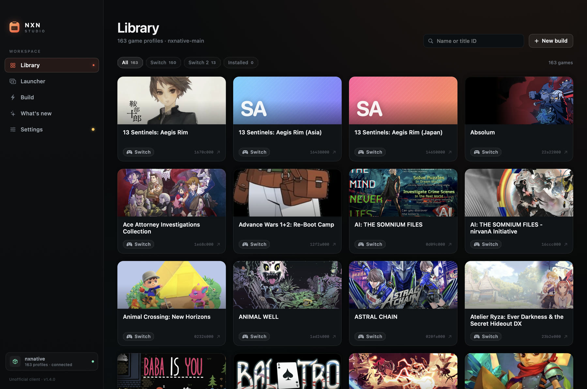
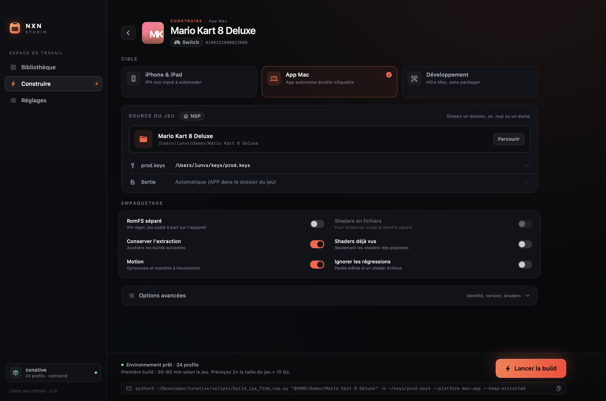
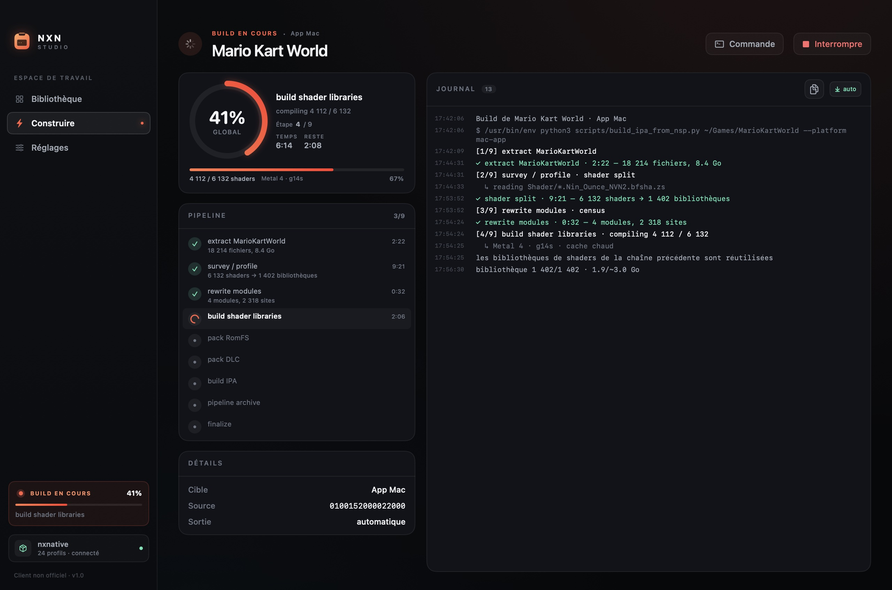
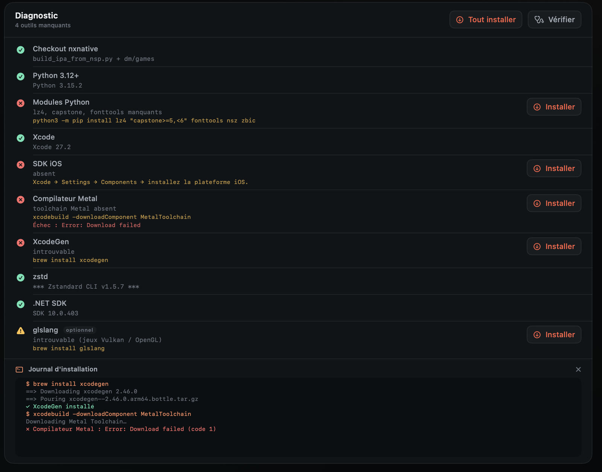
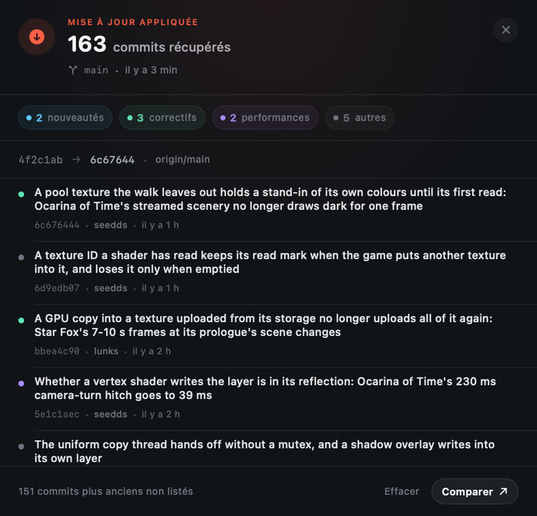
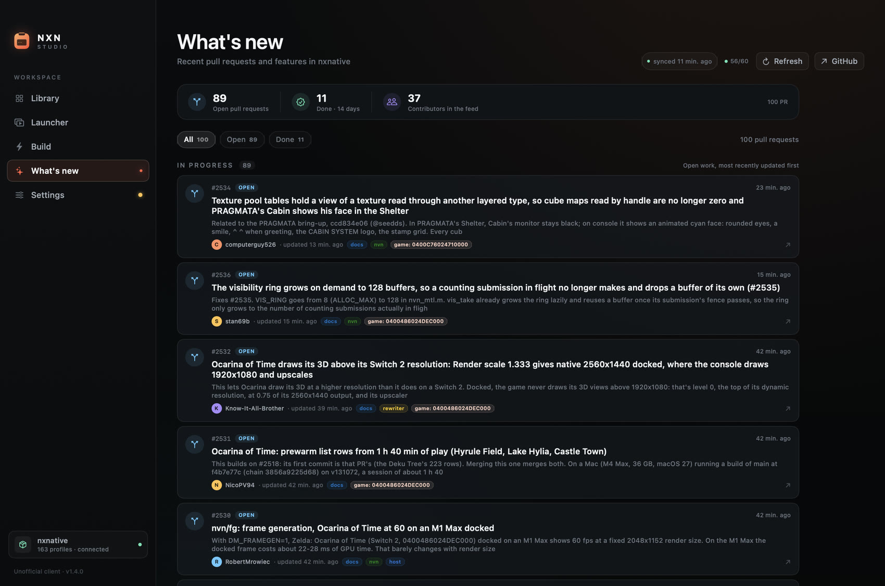
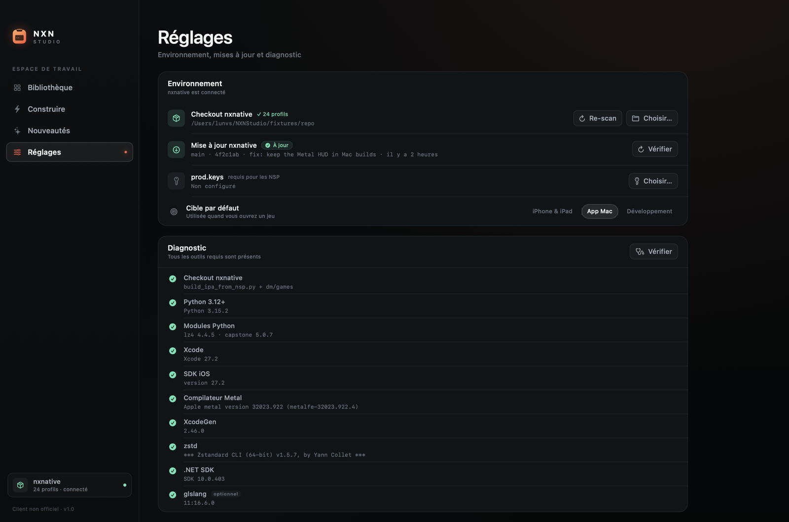
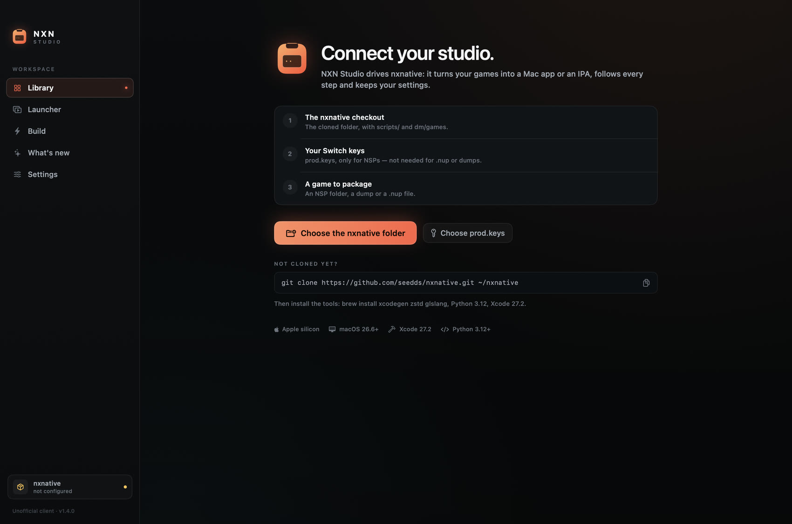
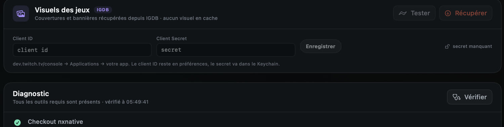

# NXN Studio

[Français](README.md) · **English**

Native macOS client (SwiftUI) for [seedds/nxnative](https://github.com/seedds/nxnative): turn a folder of Switch games into a **Mac app** or an **IPA**, without the command line — with a profile library, live build tracking, dependency installation, checkout updates and a pull-request feed.



## What it does

- **Library** — reads the 150+ profiles in `dm/games/<title id>/game.tsv` from the nxnative checkout, searches by name or title ID, filters Switch / Switch 2 / installed builds and launches a game's latest Mac app. Covers and banners can be fetched from IGDB (Twitch key) and cached locally.
- **Launcher** — scans the games already built on this Mac (bundles matching `org.nxnative.*`), shows them large with their artwork, and lets you launch them, reveal them in Finder or add one from a folder.
- **Guided build** — iPhone/iPad (IPA), Mac app or development mode; NSP, dump or `.nup` source (drag and drop supported); `prod.keys`, output, separate RomFS, shader files, language, app identity, version, GPU and diagnostics options. Updates and DLCs found next to the base package can be ticked individually.
- **Live tracking** — consumes the script's `--progress json`: progress ring, pipeline stages, counters, throughput, ETA, colourised log, auto-scroll, copy, log file. Background builds are flagged in the sidebar.
- **Installable diagnostics** — Homebrew, git, Python, modules, Xcode, iOS SDK, Metal compiler, XcodeGen, zstd, .NET and glslang, each with its command. One **Install** button per missing tool, **Install all** for the list, and a live install log with interruption.
- **nxnative updates** — `git fetch`, comparison with the upstream branch, and an **Up to date** / **N behind** badge next to the button. `git pull --ff-only` runs from the client, then profiles are reloaded. A changelog sheet lists what the last pull brought in.
- **What's new** — pull requests from the public GitHub API (single request, 100 PRs): open and recently merged work, authors, labels, filters, an unseen badge, and the remaining API quota.
- **History** — succeeded/failed builds, duration, output, reveal in Finder, direct launch of the produced Mac app.
- **Appearance** — Night / OLED / Day themes, five accent colours, sidebar or floating dock navigation, French or English interface.




## Requirements

Same as nxnative:

- Apple silicon Mac, macOS 26.6 or later.
- Xcode 27.2 + Metal toolchain (`xcodebuild -downloadComponent MetalToolchain`).
- The project checkout: `git clone https://github.com/seedds/nxnative.git ~/nxnative`.
- Python 3.12 arm64 with `lz4`, `capstone>=5,<6`, `fonttools`, `nsz`, `zbic`.
- `brew install xcodegen zstd glslang` and `brew install --cask dotnet-sdk`.
- `prod.keys` for NSPs (not needed for `.nup` or dumps).

**Settings → Diagnostics** checks all of it. Each missing row offers an **Install** button, and **Install all** runs the commands in order with a live log. Homebrew and the nxnative checkout can be installed or cloned straight from the client.



## Updates and pull requests

The **nxnative update** row (Settings → Environment) queries the upstream branch on launch. The badge shows the state:

- **Up to date** — the local checkout follows upstream.
- **N behind** — the **Update** button appears and runs `git pull --ff-only`.

After a pull, an **ⓘ N commits** chip opens a summary of what arrived: commits, a breakdown by new features / fixes / performance, authors and hash range, with a GitHub comparison link. With no recorded update, the same chip shows the checkout's 20 most recent commits. The last changelog survives relaunches until cleared.



The **What's new** page (`⌘4`) lists the repository's pull requests: work in progress, recently merged work, the points addressed, the author and labels. Data comes from the public GitHub API and is cached: nothing is sent from your Mac.





## Run

A built app lives in `dist/`:

```bash
open "dist/NXN Studio.app"
```

Or install it into your Applications folder:

```bash
./scripts/install.sh
```

On first launch, pick the `nxnative` folder (or drop it on the window). The studio remembers it. The interface is available in **French** and **English** (Settings → Appearance → Language).

### Installing on another Mac

Distribution uses the **DMG** produced by `package.sh` (`dist/NXN Studio <version>.dmg`). The app is not notarised, so macOS quarantines it:

1. Drag **NXN Studio** into *Applications*.
2. Open it once: macOS refuses.
3. *System Settings → Privacy & Security* → **Open Anyway** (or `xattr -dr com.apple.quarantine "/Applications/NXN Studio.app"`).

`scripts/install.sh` copies the app and clears the quarantine. Once the app is signed with a Developer ID and notarised, that step disappears.



## Game artwork (IGDB)

By default every game has a generative cover. To use real artwork:

1. Create an application on [dev.twitch.tv/console](https://dev.twitch.tv/console) and copy its **Client ID** and **Client Secret**.
2. Settings → **Game artwork**: paste them, **Save**, then **Test** to validate the token.
3. **Fetch** queries IGDB for each title, downloads the cover (`t_cover_big_2x`) and a banner (`t_720p`), and stores them in `~/Library/Application Support/NXN Studio/Artwork`.

The client ID stays in preferences, the secret in the **Keychain**. Artwork stays on the machine; matching is name-based (normalised, similarity score) and a title without a match keeps its generative cover. Data and images provided by IGDB.



## Build the app

```bash
./scripts/package.sh
```

The script compiles in release, generates the icon (drawn in code, `--make-icon`), assembles the bundle, signs it, and writes `dist/NXN Studio.app`, `dist/NXN Studio.dSYM` and `dist/NXN Studio <version>.dmg`.

The version comes from the `VERSION` file; the build number is a timestamp (`BUILD_NUMBER` to override).

### Developer ID signing

```bash
DEVELOPER_ID="Developer ID Application: Your Name (TEAMID)" ./scripts/package.sh
```

The script then signs the app with the hardened runtime entitlement.

### Free updates (no Apple account)

Updates don't require notarisation: the client reads a JSON manifest hosted with the releases (GitHub Releases, a static page…), checks its **Ed25519** signature and the DMG's **SHA-256**, then replaces the app. Only the *first* install needs the Gatekeeper workaround above.

1. Once, generate the key pair and keep the private key out of the repository:

```bash
"dist/NXN Studio.app/Contents/MacOS/NXNStudio" --gen-update-key
```

2. Bump `VERSION`, then `./scripts/package.sh`.
3. Build the signed manifest:

```bash
UPDATE_PRIVATE_KEY="<private key>" \
  ./scripts/publish.sh "https://github.com/<you>/<repo>/releases/download/vX.Y.Z"
```

This writes `dist/latest.json` (version, URL, size, SHA-256, Ed25519 signature, release notes).

4. Publish the DMG **and** `latest.json`, then rebuild the app pointing at the feed:

```bash
UPDATE_FEED="https://…/latest.json" \
UPDATE_PUBLIC_KEY="<public key>" \
./scripts/package.sh
```

The repository also ships `scripts/release-github.sh`, which creates the GitHub release, uploads both assets and prints the feed URL.

## Shortcuts

- `⌘1` library, `⌘2` launcher, `⌘3` build, `⌘4` what's new, `⌘5` settings
- `⌘R` rescan profiles
- `⇧⌘D` check the environment

## Architecture

```
Sources/NXNStudio/
  App.swift                 entry point, window, icon, snapshot mode
  Models/
    Game.swift              game.tsv parsing, build options, CLI arguments
    AppState.swift          preferences, library, history, routes
    BuildRunner.swift       Process + JSON event parsing
    BuildContent.swift      base / update / DLC detection
    ToolchainChecker.swift  environment diagnostics
    ShellRunner.swift       command execution and streaming
    DependencyInstaller.swift dependency catalogue and installation
    RepoUpdate.swift        git fetch / pull, checkout state, changelog
    RepoNews.swift          GitHub API, cache, pull requests
    ArtworkStore.swift      IGDB lookup and artwork cache
    Launcher.swift          scanning built games on the Mac
    UpdateService.swift     signed app updates
    Localization.swift      French/English table
  Design/
    Theme.swift             palette, themes, typography, formatting
    Components.swift        cards, buttons, ring, generative cover art
  Views/
    RootView.swift          window, sidebar, dock, page header
    LibraryView.swift       grid, filters, cards
    LauncherView.swift      big-picture grid of installed games
    BuildView.swift         build form
    BuildMonitorView.swift  progress + log
    NewsView.swift          pull requests and repository activity
    SettingsView.swift      environment, update, diagnostics, appearance, history
    OnboardingView.swift    first launch
```

The client does not modify nxnative: it calls `scripts/build_ipa_from_nsp.py` with the interface's arguments and `--progress json`, then reads events line by line. Updates only go through `git fetch` then `git pull --ff-only`, without touching local changes. Every build writes its full log to `~/Library/Logs/NXN Studio/`. Keys never leave the machine.

## Notes

Unofficial client, not affiliated with Nintendo or the nxnative authors. The client is distributed under the MIT licence (see `LICENSE`); nxnative keeps its own. No game is included; use your own copies only.
