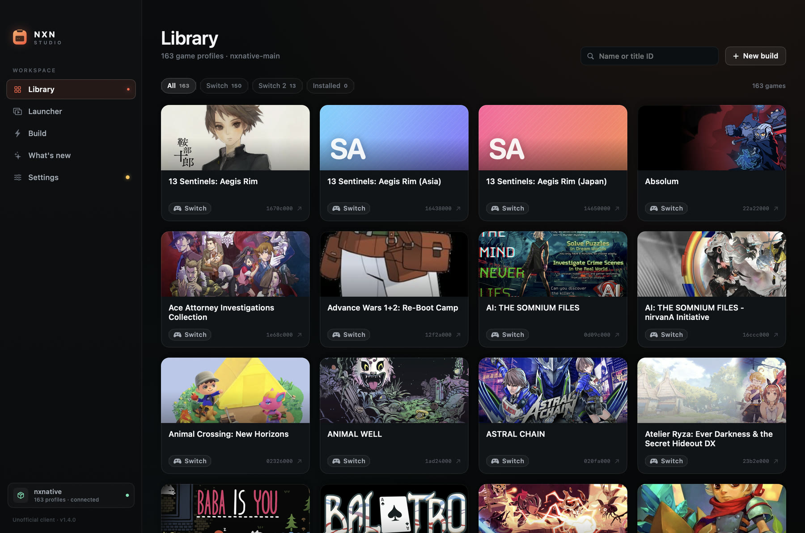
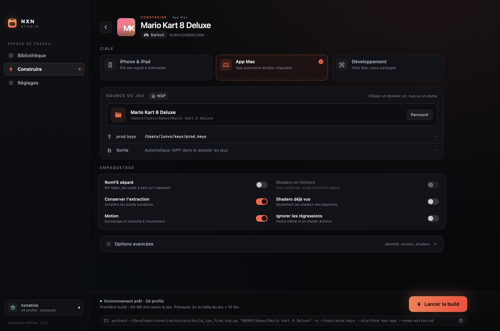
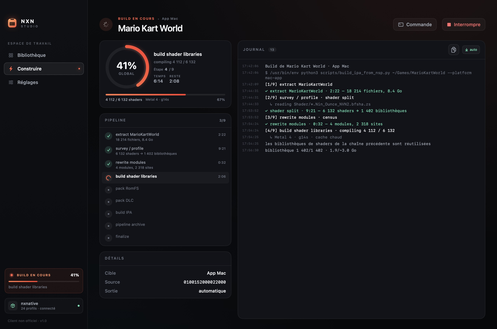
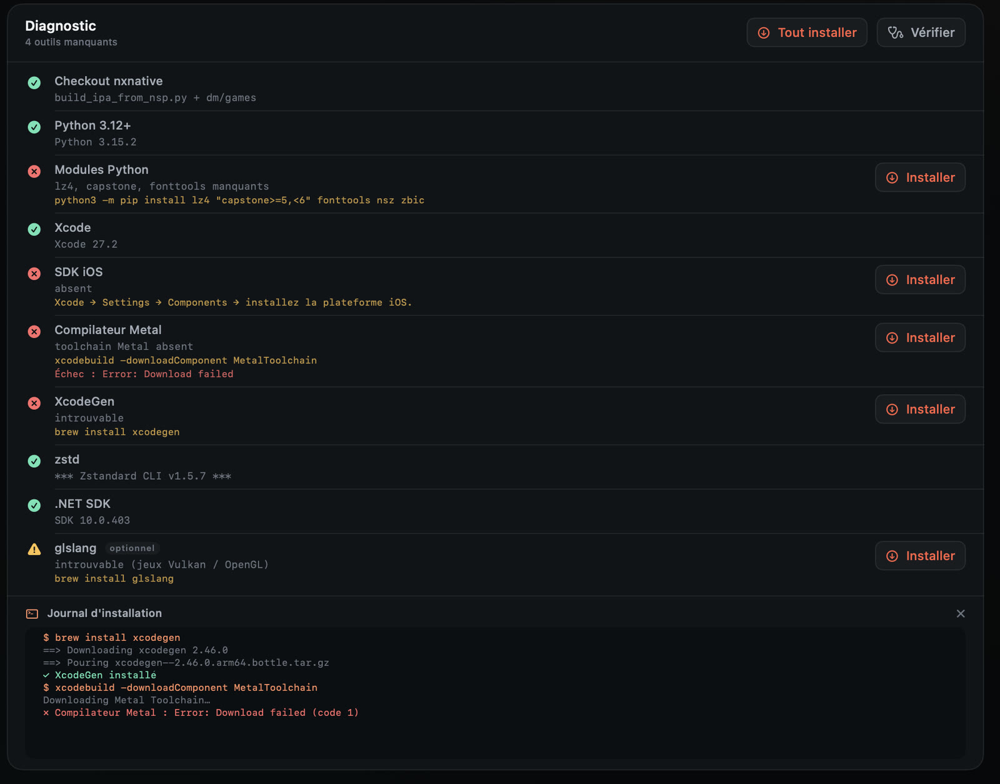
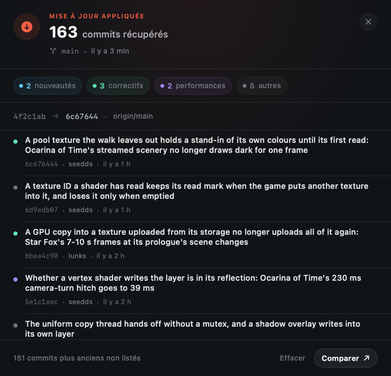
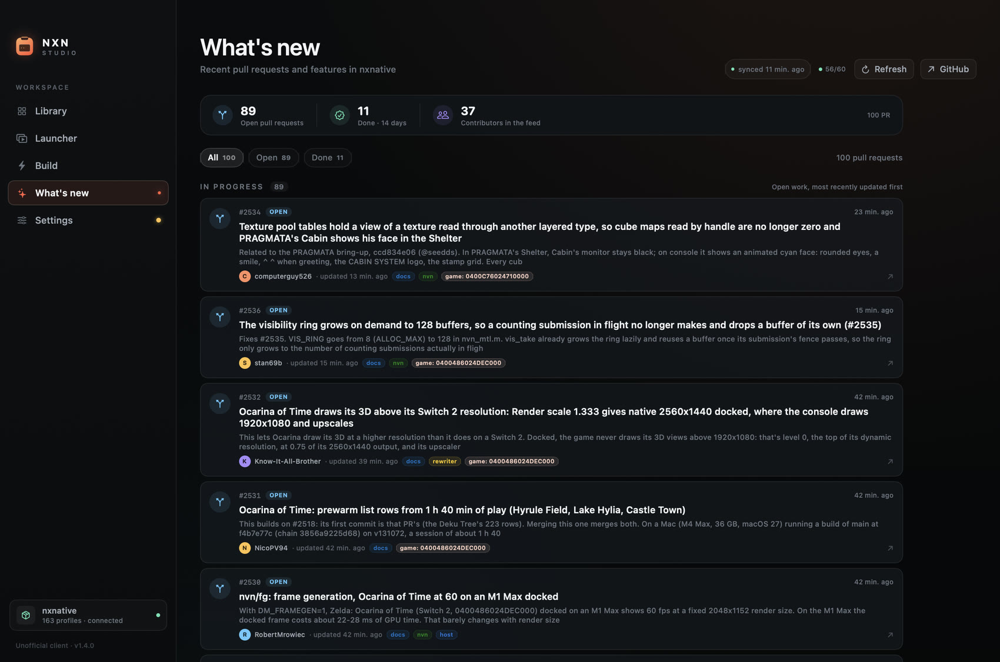
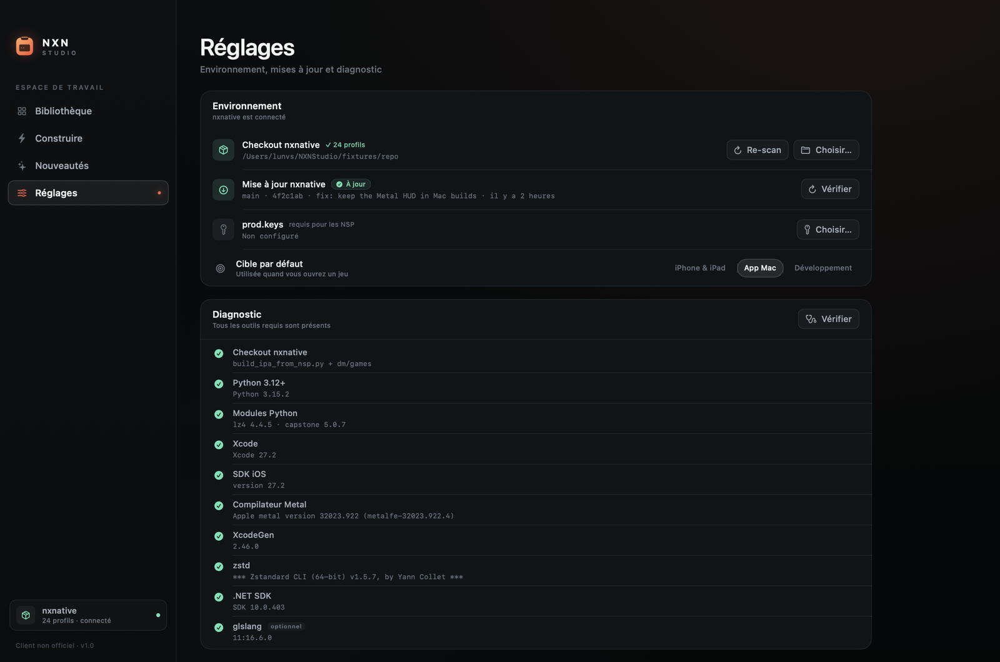
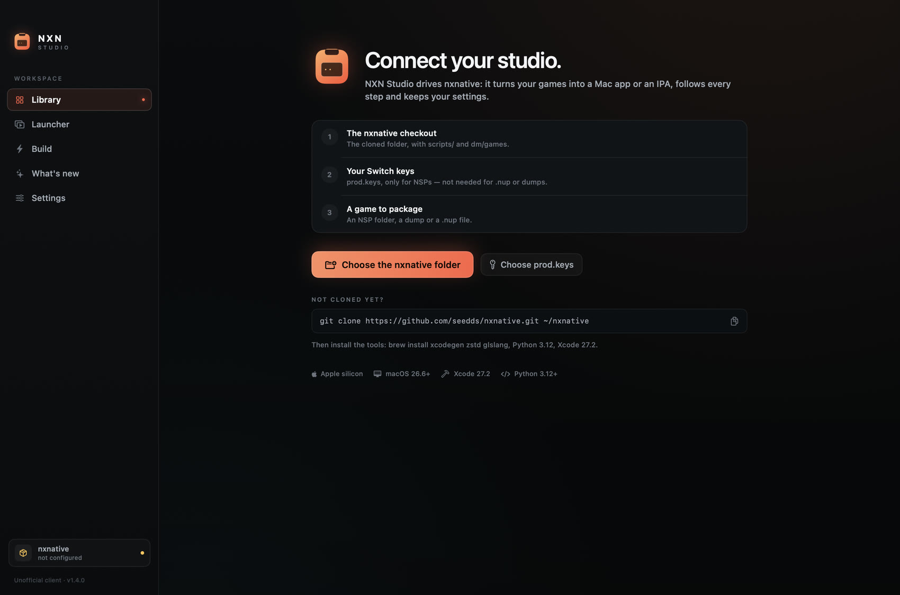
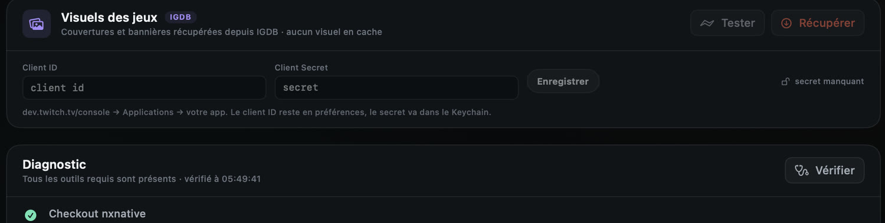

# NXN Studio

**Français** · [English](README.en.md)

Client macOS natif (SwiftUI) pour [seedds/nxnative](https://github.com/seedds/nxnative) : transformer un dossier de jeux Switch en **app Mac** ou en **IPA**, sans ligne de commande, avec une bibliothèque de profils, un suivi de build en direct, l'installation des dépendances, la mise à jour du checkout et une veille des pull requests du dépôt.



## Ce qu'il fait

- **Bibliothèque** — lit les 150+ profils de `dm/games/<title id>/game.tsv` du checkout nxnative, recherche par nom ou title ID, filtre Switch / Switch 2 / builds installées, lance la dernière app Mac d'un jeu. Les couvertures et bannières peuvent être récupérées depuis IGDB (clé Twitch) et mises en cache localement.
- **Build guidée** — cible iPhone/iPad (IPA), app Mac ou mode développement ; source NSP, dump ou `.nup` (glisser-déposer accepté) ; `prod.keys`, sortie, RomFS séparé, shader files, langue, identité de l'app, version, GPU et options de diagnostic.
- **Suivi temps réel** — consomme `--progress json` du script : anneau de progression, étapes du pipeline, compteurs, débit, ETA, journal coloré, autoscroll, copie, fichier de log. Build en arrière-plan signalée dans la barre latérale.
- **Diagnostic installable** — Python, modules, Xcode, SDK iOS, compilateur Metal, XcodeGen, zstd, .NET et glslang, chacun avec sa commande. Un bouton **Installer** par outil manquant, un bouton **Tout installer** pour la liste, et un journal d'installation en direct avec interruption.
- **Mise à jour de nxnative** — `git fetch`, comparaison avec la branche amont et pastille « À jour » ou « N commits de retard » à côté du bouton. `git pull --ff-only` lancé depuis le client, puis réanalyse des profils.
- **Nouveautés** — page dédiée au dépôt : pull requests ouvertes et récemment fusionnées lues depuis l'API GitHub publique (une seule requête, 100 PR), points travaillés, auteurs, labels, filtres, badge des nouveautés depuis la dernière visite et quota d'API restant affiché discrètement.
- **Launcher** — scanne les jeux déjà construits sur le Mac (bundle `org.nxnative.*`), les affiche en grand avec leur artwork, permet de les lancer, de les révéler dans le Finder et d'en ajouter un depuis un dossier.
- **Historique** — builds réussies/échouées, durée, sortie, révélation dans le Finder, lecture directe de l'app Mac produite.




## Prérequis

Identiques à nxnative :

- Mac Apple silicon, macOS 26.6 ou plus récent.
- Xcode 27.2 + toolchain Metal (`xcodebuild -downloadComponent MetalToolchain`).
- Le checkout du projet : `git clone https://github.com/seedds/nxnative.git ~/nxnative`.
- Python 3.12 arm64 avec `lz4`, `capstone>=5,<6`, `fonttools`, `nsz`, `zbic`.
- `brew install xcodegen zstd glslang` et `brew install --cask dotnet-sdk`.
- `prod.keys` pour les NSP (inutile pour les `.nup` et les dumps).

Le panneau **Réglages → Diagnostic** vérifie tout ça. Chaque ligne manquante propose son bouton **Installer**, et **Tout installer** enchaîne les commandes dans l'ordre avec un journal en direct.



## Mise à jour et nouveautés

Le bloc **Mise à jour nxnative** (Réglages → Environnement) interroge la branche amont au lancement. La pastille indique l'état :

- **À jour** — le checkout local suit la branche amont.
- **N commits de retard** — le bouton **Mettre à jour** apparaît et lance `git pull --ff-only`.

Après un `pull`, une pastille **ⓘ N commits** apparaît à côté du statut : elle ouvre le détail de ce qui vient d'arriver — commits récupérés, répartition nouveautés / correctifs / performances, auteurs et plage de hachages, avec un lien vers la comparaison GitHub. Sans mise à jour enregistrée, la même pastille affiche les 20 derniers commits du checkout. Le dernier changelog est conservé entre deux lancements jusqu'à ce qu'on l'efface.



La page **Nouveautés** (`⌘3`) liste les pull requests du dépôt nxnative : ce qui est en cours, ce qui vient d'être fusionné, les points travaillés, l'auteur et les labels. Les données viennent de l'API GitHub publique et sont mises en cache : rien n'est envoyé depuis votre Mac.





## Lancer

Une app déjà construite est dans `dist/` :

```bash
open "dist/NXN Studio.app"
```

Ou pour l'installer dans votre dossier Applications :

```bash
./scripts/install.sh
```

Au premier lancement, choisissez le dossier `nxnative` (ou glissez-le sur la fenêtre). Le studio le mémorise. L'interface est disponible en **français** et en **anglais** (Réglages → Apparence → Langue).

### Installer sur un autre Mac

Le partage se fait par le **DMG** produit par `package.sh` (`dist/NXN Studio <version>.dmg`). Tant que l'app n'est pas notarisée, macOS la met en quarantaine :

1. Glissez **NXN Studio** dans *Applications*.
2. Ouvrez-la une fois : macOS refuse.
3. *Réglages Système → Confidentialité et sécurité* → **Ouvrir quand même** (ou `xattr -dr com.apple.quarantine "/Applications/NXN Studio.app"`).

`scripts/install.sh` fait la copie et lève la quarantaine automatiquement. Une fois l'app signée avec un *Developer ID* et notarisée, cette étape disparaît.



## Visuels des jeux (IGDB)

Par défaut, chaque jeu a une couverture générative. Pour utiliser les vraies jaquettes :

1. Créez une application sur [dev.twitch.tv/console](https://dev.twitch.tv/console) et récupérez son **Client ID** et son **Client Secret**.
2. Réglages → **Visuels des jeux** : collez-les, **Enregistrer**, puis **Tester** pour valider le jeton.
3. **Récupérer** interroge IGDB pour chaque titre, télécharge la jaquette (`t_cover_big_2x`) et une bannière (`t_720p`), puis les range dans `~/Library/Application Support/NXN Studio/Artwork`.

Le client ID reste dans les préférences, le secret dans le **Keychain**. Les visuels restent sur la machine ; la correspondance se fait par nom (normalisé, score de similarité) et un titre sans correspondance garde sa couverture générative. Données et images fournies par IGDB.



## Construire l'app

```bash
./scripts/package.sh
```

Le script compile en release, génère l'icône (dessinée par le code, `--make-icon`), assemble le bundle, le signe et écrit `dist/NXN Studio.app`, `dist/NXN Studio.dSYM` et `dist/NXN Studio <version>.dmg`.

La version vient du fichier `VERSION` ; le numéro de build est horodaté (`BUILD_NUMBER` pour le forcer).

### Signature Developer ID

```bash
DEVELOPER_ID="Developer ID Application: Ton Nom (TEAMID)" ./scripts/package.sh
```

Le script signe alors l'app avec l'entitlement *hardened runtime*.

### Mises à jour gratuites (sans compte Apple)

Aucune notarisation n'est nécessaire pour les mises à jour : le client lit un manifeste JSON hébergé avec les releases (GitHub Releases, page statique…), vérifie sa **signature Ed25519** et l'**empreinte SHA-256** du DMG, puis remplace l'app. Seule la *première* installation demande le contournement Gatekeeper décrit plus haut.

1. Une seule fois, génère la paire de clés et garde la privée hors du dépôt :

```bash
"dist/NXN Studio.app/Contents/MacOS/NXNStudio" --gen-update-key
```

2. Incrémente `VERSION`, puis `./scripts/package.sh`.
3. Construis le manifeste signé :

```bash
UPDATE_PRIVATE_KEY="<clé privée>" \
  ./scripts/publish.sh "https://github.com/<toi>/<repo>/releases/download/vX.Y.Z"
```

Cela écrit `dist/latest.json` (version, URL, taille, SHA-256, signature Ed25519, notes) et rappelle la commande de packaging à utiliser.

4. Publie le DMG **et** `latest.json`, puis reconstruis l'app en pointant le flux et la clé publique :

```bash
UPDATE_FEED="https://…/latest.json" \
UPDATE_PUBLIC_KEY="<clé publique>" \
./scripts/package.sh
```

Dans l'app, **menu NXN Studio → Vérifier les mises à jour…** affiche une feuille avec les notes, **Télécharger le DMG** ou **Installer maintenant** (téléchargement, vérification de la signature, remplacement dans `Applications`, relance). Sans clé publique ou sans signature dans le manifeste, seule le téléchargement manuel est proposé.

## Architecture

```
Sources/NXNStudio/
  App.swift                 entrée, fenêtre, icône, mode capture
  Models/
    Game.swift              parsing game.tsv, options de build, arguments CLI
    AppState.swift          préférences, bibliothèque, historique
    BuildRunner.swift       Process + parsing des événements JSON
    ToolchainChecker.swift  diagnostic de l'environnement
    ShellRunner.swift       exécution et streaming de commandes
    DependencyInstaller.swift catalogue et installation des dépendances
    RepoUpdate.swift        git fetch / pull, état du checkout
    RepoNews.swift          API GitHub, cache et nouveautés
  Design/
    Theme.swift             palette, typographie, formatage
    Components.swift        cartes, boutons, anneau, cover art générative
  Views/
    RootView.swift          fenêtre, sidebar, fond
    LibraryView.swift       grille, filtres, cartes
    BuildView.swift         formulaire de build
    BuildMonitorView.swift  progression + journal
    NewsView.swift          pull requests et activité du dépôt
    SettingsView.swift      environnement, mise à jour, diagnostic, installation, historique
    OnboardingView.swift    premier lancement
```

Le client ne modifie pas nxnative : il appelle `scripts/build_ipa_from_nsp.py` avec les arguments de l'interface et `--progress json`, puis lit les événements ligne par ligne. Les mises à jour passent uniquement par `git fetch` puis `git pull --ff-only`, sans toucher aux modifications locales. Chaque build écrit son journal complet dans `~/Library/Logs/NXN Studio/`. Les clés ne quittent jamais la machine.

## Raccourcis

- `⌘1` bibliothèque, `⌘2` launcher, `⌘3` construire, `⌘4` nouveautés, `⌘5` réglages
- `⌘R` réanalyser les profils
- `⇧⌘D` vérifier l'environnement

## Notes

Client non officiel, sans affiliation avec Nintendo ni les auteurs de nxnative. Le client est distribué sous licence MIT (voir `LICENSE`) ; nxnative garde la sienne. Aucun jeu n'est inclus ; n'utilisez que vos propres copies. nxnative et ses dépendances gardent leurs licences respectives (MIT pour nxnative).
